

  

<h1 align="center">JC Method</h1>

<strong>Una plataforma para conectar la planificación del coach con el entrenamiento diario del cliente.</strong>

  
  
  
  
  
  

  <a href="#la-plataforma">Plataforma</a> · <a href="#el-perrito-que-acompaña-el-progreso">El perrito</a> · <a href="#recorrido-visual">Capturas</a> · <a href="#mi-participación">Mi participación</a>

> **Showcase profesional.** El código fuente de JC Method es privado. Este repositorio contiene exclusivamente su presentación y recursos visuales. Todas las capturas usan datos ficticios.

## La plataforma

JC Method organiza el trabajo entre coach y cliente: permite preparar y asignar rutinas, registrar entrenamientos y consultar el progreso desde una experiencia web adaptada a dispositivos móviles.

El objetivo es que el cliente tenga claridad sobre qué entrenar y cómo mantener la constancia, mientras el coach dispone de herramientas para organizar sus planes y dar seguimiento a cada persona.

### Experiencia del cliente

- Acceso a su rutina, días de entrenamiento y ejercicios asignados.
- Consulta de series, repeticiones, descanso, RIR e indicaciones del coach.
- Inicio y finalización de entrenamientos, registro de peso y repeticiones por serie, y temporizador de descanso.
- Referencia de la última sesión de cada ejercicio para acompañar la progresión.
- Seguimiento de objetivos diarios de entrenamiento, alimentación y pasos, con resumen e historial semanal.
- Perfil con registro de peso, notas del coach y fotos de progreso privadas.
- Acceso a demostraciones de ejercicios mediante YouTube cuando existe una demostración aprobada.

### Herramientas del coach

- Panel de seguimiento con actividad reciente y clientes que requieren atención.
- Gestión de clientes, asignación de rutinas y programación de entrenamientos.
- Creación y edición de planes, días y ejercicios; reorganización de ejercicios mediante arrastrar y soltar.
- Configuración de series, repeticiones, descanso, tempo, RIR/RPE y notas técnicas.
- Catálogo de ejercicios y revisión de sus demostraciones.
- Consulta de historial de entrenamientos, progreso semanal y notas de seguimiento.

## El perrito que acompaña el progreso

El personaje convierte el avance semanal en una señal visual cercana y motivadora. **Las cinco etapas existen en JC Method y ya están integradas en el panel del cliente**: el personaje cambia conforme avanza su progreso semanal.

  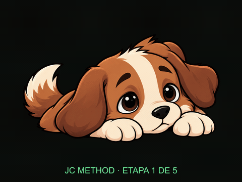

<em>Las cinco etapas originales, en orden. La animación se preparó para este showcase a partir de los assets existentes.</em>

  
  
  
  
  

La gamificación visible se centra en completar objetivos, consultar la constancia semanal y ver evolucionar al personaje. Las imágenes conservan sus etapas reales; aquí no se publican algoritmos ni reglas internas de progresión.

**Estado de los desafíos:** existe soporte en el backend para crear, asignar y consultar desafíos. La interfaz revisada no ofrece una pantalla específica de desafíos; por eso no se incluye una captura ni se presenta esa experiencia visual como terminada. Los objetivos diarios mostrados a continuación sí pertenecen a la interfaz actual.

## Recorrido visual

Capturas reales de la interfaz ejecutada localmente en Chromium, con respuestas de una API local de prueba y datos completamente ficticios. Se muestran vistas de escritorio, una vista móvil y recortes de componentes reales; no son maquetas.

### Acceso

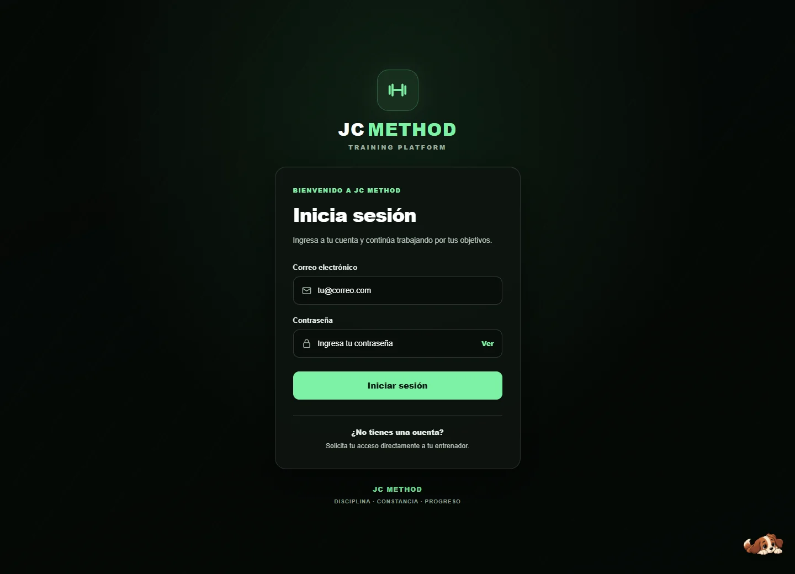

### Cliente · inicio y experiencia móvil

| Panel principal | Vista móvil |
| --- | --- |
| 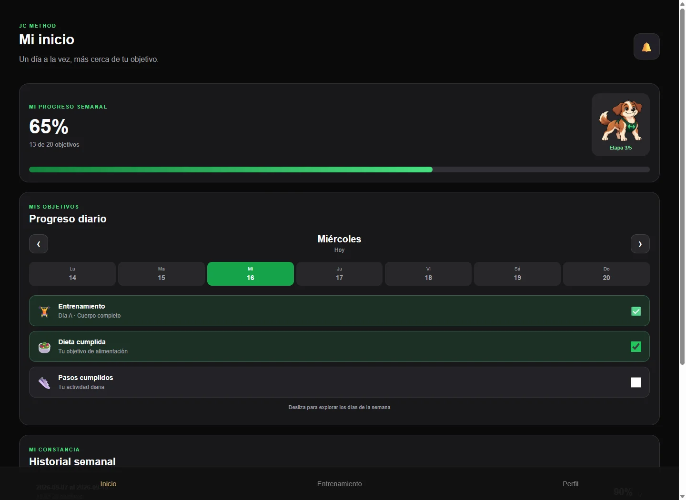 | 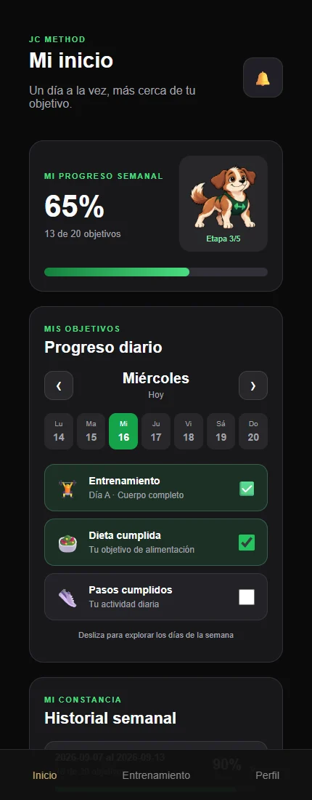 |

### Progreso · constancia y objetivos

| Historial semanal | Objetivos diarios |
| --- | --- |
| 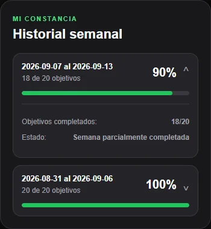 | 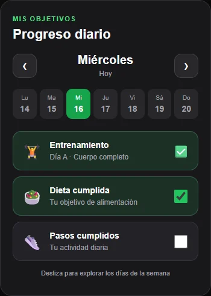 |

### Entrenamiento · rutinas y ejercicios

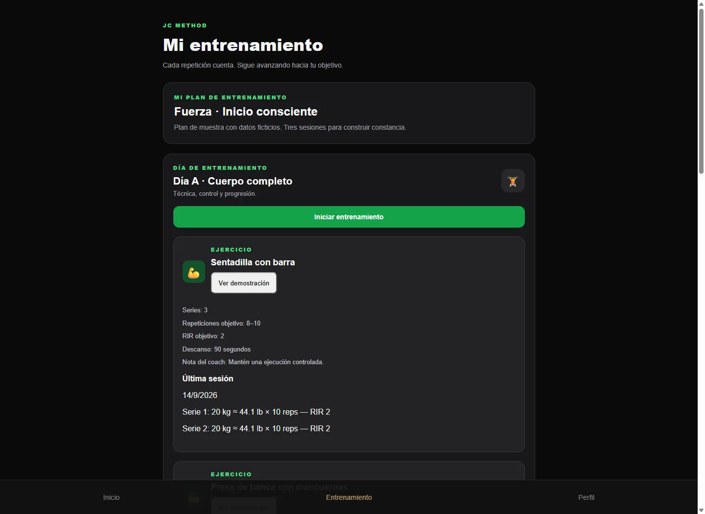

### Demostraciones de ejercicios

El botón **Ver demostración** abre el reproductor de la demostración aprobada, incluyendo la integración con YouTube. La captura muestra el acceso real desde el ejercicio. No se reproducen ni redistribuyen videos, miniaturas ni fotogramas de terceros en este repositorio.

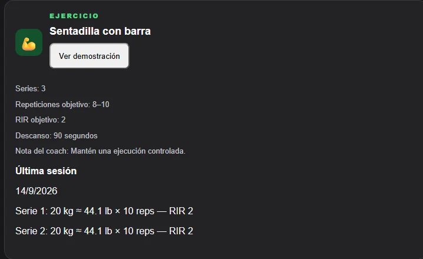

### Coach · seguimiento de clientes

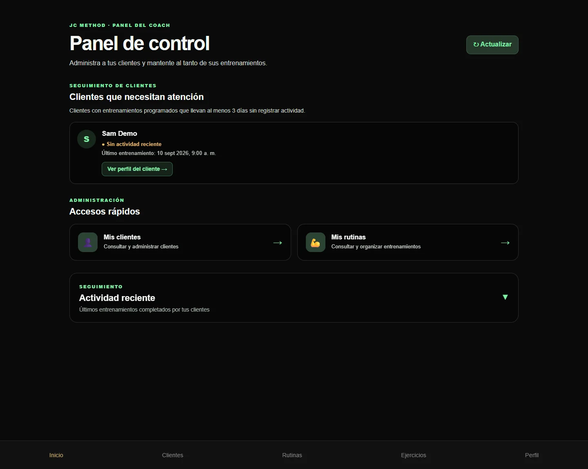

### Coach · gestión y edición de rutinas

| Biblioteca de rutinas | Organización de días y ejercicios |
| --- | --- |
| 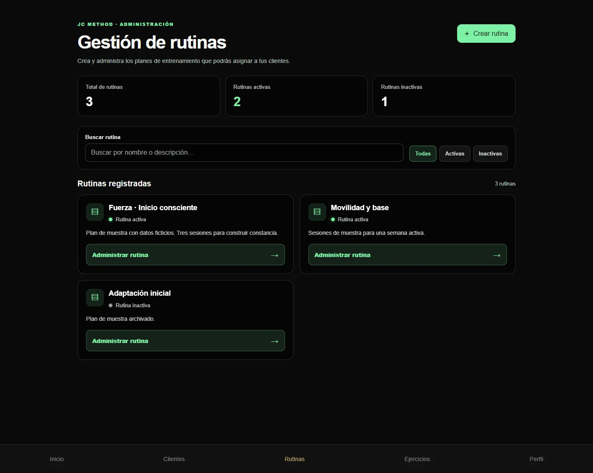 | 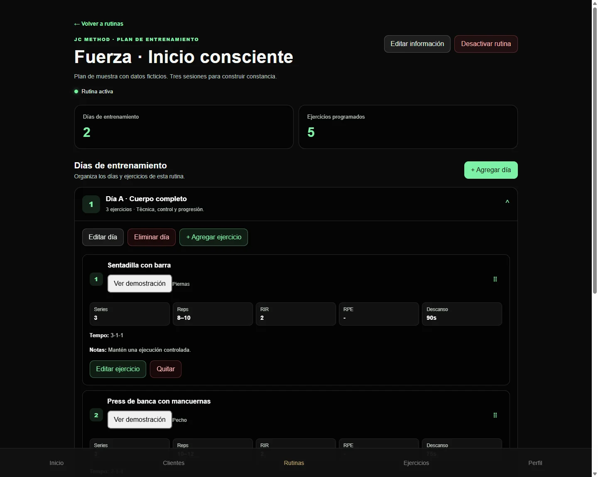 |

## Tecnologías

| Tecnología | Papel en JC Method |
| --- | --- |
| **React** | Interfaz por componentes, navegación y vistas de cliente y coach. |
| **Node.js + Express** | Backend y API para los flujos de entrenamiento y seguimiento. |
| **PostgreSQL** | Persistencia de usuarios, planes y registros de progreso. |
| **PWA** | Experiencia instalable, manifiesto y service worker para la aplicación web. |
| **Railway** | Alojamiento y despliegue de la plataforma. |

El diseño responsive adapta las vistas y la navegación al tamaño de pantalla. La experiencia móvil prioriza consultar la rutina y registrar el entrenamiento desde el teléfono.

## Mi participación

Participé como **desarrollador full stack** en la construcción de JC Method: desarrollo de las interfaces de cliente y coach con React, implementación de la API con Node.js y Express, integración con PostgreSQL y desarrollo de los flujos de rutinas, entrenamientos y seguimiento.

Mi trabajo también abarca la experiencia responsive, la integración PWA, las demostraciones de ejercicios y el despliegue en Railway. Este showcase documenta el resultado visual y las funcionalidades presentes en el proyecto.

## Alcance y privacidad

- **Código fuente privado:** este repositorio es independiente y no distribuye el frontend, el backend ni su historial Git.
- **Datos ficticios:** nombres, cargas, fechas, planes y actividad se generaron para las capturas. No se utilizaron cuentas, bases de datos ni fotografías de clientes reales.
- **Presentación aislada:** las capturas se produjeron localmente sin conexión a producción. El fondo fotográfico del proyecto se excluyó de este entorno por no verificar su licencia de redistribución.
- **Recursos visuales:** las cinco etapas del perrito se incluyen con permiso de publicación confirmado por el titular del proyecto. Su presencia pública no concede una licencia general de reutilización.
- **Contenido limitado:** únicamente README y recursos de presentación; sin credenciales, endpoints privados, documentación interna ni material audiovisual de terceros.

JC Method · Proyecto de portafolio profesional · Código fuente privado

